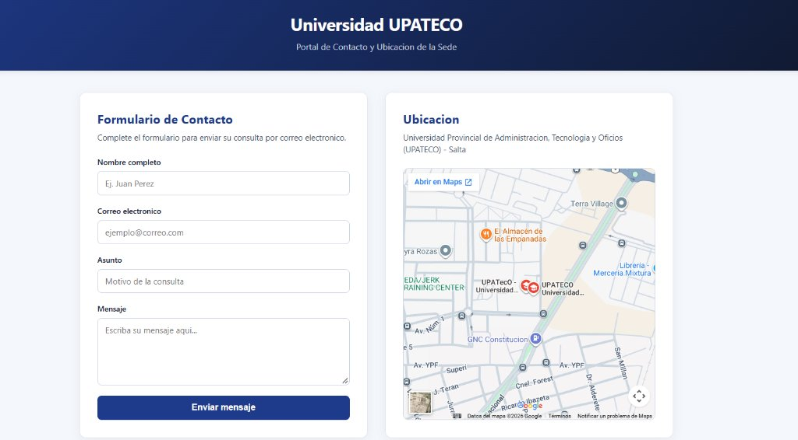
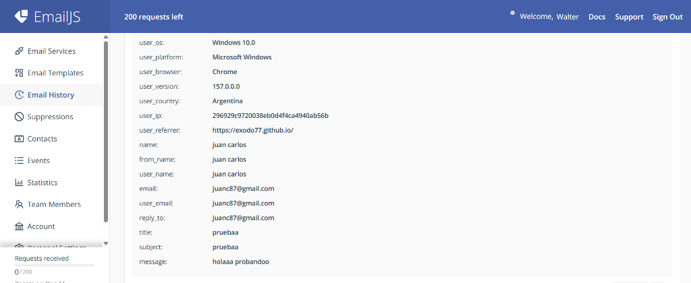

# Portal de Contacto - Universidad UPATECO

Sitio web desarrollado con **React** y **Vite** que integra un formulario de contacto funcional conectado a **EmailJS** junto con la ubicacion en el mapa de la sede central de la **Universidad Provincial de Administracion, Tecnologia y Oficios (UPATECO)** en Salta.

- **Sitio publicado en vivo:** [https://exodo77.github.io/Recu-TP/](https://exodo77.github.io/Recu-TP/)

---

## Vista general del sitio



---

## Como funciona

El sitio cuenta con una interfaz dividida en dos secciones principales adaptables a cualquier pantalla:

1. **Formulario de contacto con EmailJS**:
   - El usuario ingresa su nombre completo, correo electronico, asunto y mensaje.
   - Al presionar **Enviar mensaje**, la aplicacion utiliza la libreria `@emailjs/browser` para conectarse directamente con el servicio de correo configurado en EmailJS sin necesidad de un servidor intermedio.
   - Mientras se procesa el envio, el boton indica el estado en curso y, al finalizar, muestra una confirmacion en pantalla y limpia los campos automaticamente.

2. **Mapa interactivo de UPATECO**:
   - Al lado del formulario se encuentra embebido el mapa de Google Maps apuntando directamente a la sede de la **Universidad UPATECO** en la ciudad de Salta, permitiendo consultar la ubicacion exacta y hacer zoom o abrir indicaciones.

---

## Muestra de funcionamiento

A continuacion se observa en el historial de **EmailJS (`Email History`)** la recepcion real de un mensaje enviado desde el sitio publicado en GitHub Pages (`https://exodo77.github.io/`), verificando que los datos del formulario llegan correctamente a la casilla de correo:



---

## Tecnologias utilizadas

| Componente | Herramienta |
|------------|-------------|
| Interfaz de usuario | React 18 |
| Empaquetador y entorno | Vite 5 |
| Servicio de correo | EmailJS (`@emailjs/browser`) |
| Publicacion continua | GitHub Actions + GitHub Pages |

---

## Ejecucion en entorno local

1. Instalar las dependencias del proyecto:
   ```bash
   npm install
   ```
2. Iniciar el servidor de desarrollo:
   ```bash
   npm run dev
   ```
3. Abrir `http://localhost:5173/` en el navegador.
